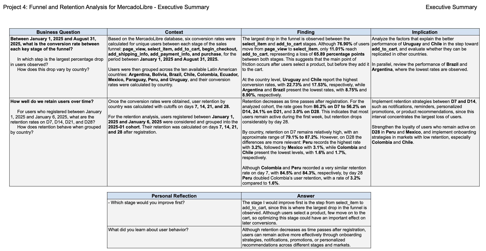
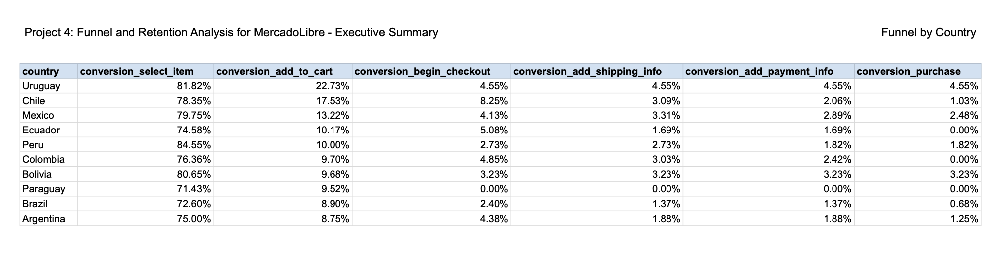
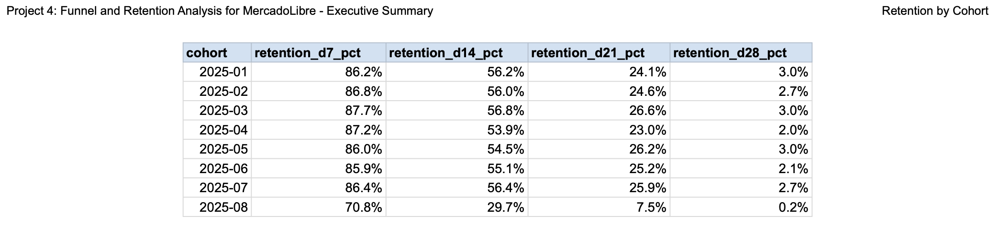
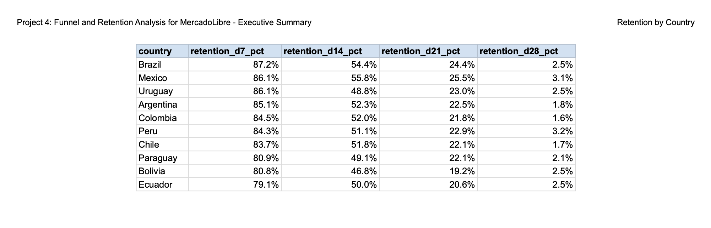

# MercadoLibre Funnel and Retention Analysis

**Author:** [Rodrigo Garza García](https://www.linkedin.com/in/rodrigogarzamx/)  
**Professional focus:** Public & International Affairs · Business Analysis · Data Analytics  
**Portfolio page:** [MercadoLibre](https://rogarzag.github.io/projects/mercadolibre/)  
**GitHub repository:** [mercadolibre-funnel-retention-analysis](https://github.com/rogarzag/mercadolibre-funnel-retention-analysis)  
**Project focus:** Data Analytics · SQL · Conversion Funnel · Cohort Analysis · Retention Analysis  
**Project context:** TripleTen Data Analyst Bootcamp; SQL portfolio project  
**Data / project coverage:** January–August 2025; ten Latin American countries  
**Professional links:** [GitHub profile](https://github.com/rogarzag) · [LinkedIn](https://www.linkedin.com/in/rodrigogarzamx/) · [Professional Website](https://rogarzag.github.io/)

## Project Overview

SQL-based analysis of MercadoLibre’s conversion funnel and user retention across ten Latin American countries.

This project evaluates user behavior across the e-commerce conversion funnel and analyzes retention on days 7, 14, 21 and 28.

The analysis aimed to identify where users left the conversion funnel, compare funnel and retention results across countries, and review retention across cohorts.

The analysis covers activity from January to August 2025.

### Executive summary

## Business questions

The project addresses the following questions:

- At which stage does the largest conversion drop occur?
- Which countries achieve the strongest and weakest funnel performance?
- How does user retention change between D7, D14, D21 and D28?
- Which countries and cohorts show the strongest long-term retention?
- What actions could improve conversion and user engagement?

## Analysis methodology

The analysis was completed using SQL in TripleTen’s learning environment.

The analysis included:

- Organizing user events by funnel stage.
- Calculating the percentage of users reaching each stage.
- Comparing funnel performance across ten Latin American countries.
- Calculating retention at D7, D14, D21 and D28.
- Comparing retention by country and by monthly cohort.

## Conversion funnel

The overall funnel results were:

| Funnel stage | Conversion rate |
|---|---:|
| Select item | 76.90% |
| Add to cart | 11.01% |
| Begin checkout | 4.00% |
| Add shipping information | 2.42% |
| Add payment information | 2.09% |
| Purchase | 1.25% |

The largest drop occurred between **product selection and cart addition**, representing a decrease of **65.89 percentage points**.

This indicates that the main conversion challenge occurs before users formally begin the purchasing process.

## Funnel performance by country

Country-level analysis identified important differences in cart addition performance:

- Uruguay: 22.73%
- Chile: 17.53%
- Brazil: 8.90%
- Argentina: 8.75%

Uruguay and Chile recorded the strongest results at the add-to-cart stage, while Argentina and Brazil showed the greatest opportunity for improvement.

## Retention analysis

Retention was evaluated at:

- D7
- D14
- D21
- D28

For the January 1–6 cohort, retention declined as follows:

| Retention period | Retention rate |
|---|---:|
| D7 | 86.2% |
| D14 | 56.2% |
| D21 | 24.1% |
| D28 | 3.0% |

For the January 1–6, 2025 registration group described in the executive summary, retention declined from 86.2% on D7 to 56.2% on D14, 24.1% on D21 and 3.0% on D28. The workbook also includes a separate monthly cohort table from January to August 2025.

## Retention by country

At D28, the strongest retention results were observed in:

- Peru: 3.2%
- Mexico: 3.1%

The lowest D28 results included:

- Chile: 1.7%
- Colombia: 1.6%

Although overall long-term retention was low, Peru and Mexico showed comparatively stronger performance.

## Key findings

- The main funnel bottleneck occurs between product selection and cart addition.
- Only 1.25% of users completed a purchase.
- Uruguay and Chile performed best at the add-to-cart stage.
- Argentina and Brazil showed the weakest cart addition results.
- Retention declined sharply after D7.
- Long-term retention at D28 remained close to 3% or lower.
- Peru and Mexico achieved the strongest D28 retention results.

## Business recommendations

### Improve the transition from product selection to cart

The executive summary recommends analyzing why Uruguay and Chile have higher add-to-cart rates and reviewing the lower rates in Brazil and Argentina. It does not identify the causes of these differences.

### Strengthen retention between D7 and D14

The executive summary suggests notifications, reminders, personalized promotions and product recommendations between D7 and D14. It also suggests strengthening loyalty among users active on D28 in Peru and Mexico, and reviewing onboarding in countries with lower retention, particularly Colombia and Chile.

### Investigate country-level differences

The executive summary recommends reviewing the factors behind the higher add-to-cart rates in Uruguay and Chile, and examining the lower rates in Brazil and Argentina. For retention, it suggests reviewing the D7–D14 period and the country differences shown in the workbook.

## Tools and skills

- SQL
- Common Table Expressions
- Funnel Analysis
- Cohort Analysis
- Retention Analysis
- Data Validation
- Business Analysis
- KPI Interpretation
- Executive Reporting

## Project workbook

The complete project workbook, including results, tables and visualizations, is available in Google Sheets:

[Open the MercadoLibre Funnel and Retention Analysis workbook](https://docs.google.com/spreadsheets/d/1j0Ln3y3g58qErGPMvOTCVIhawGD_T5hNhAE8IP0xCd0/edit?usp=drive_link)

## Project files

The analysis was originally developed in TripleTen’s SQL learning environment. The original SQL queries are not currently available outside the platform.

This repository documents the business problem, methodology, principal findings and recommendations. SQL files may be added later if the original queries are recovered or reconstructed.

## Limitations

- The analysis is descriptive and does not establish causality.
- The available results summarize user behavior but do not include qualitative information explaining why users abandoned the funnel.
- Additional variables such as device type, acquisition channel, product category and campaign source could support deeper analysis.
- Long-term retention should be interpreted in the context of the available observation period.

## Conclusion

The workbook shows the largest funnel drop between select_item and add_to_cart: 76.90% of users reached select_item, while 11.01% reached add_to_cart. It also shows that retention for the January 1–6 group declined from 86.2% on D7 to 3.0% on D28. The analysis compares these results across countries and cohorts, but does not establish why users leave the funnel or which actions would improve retention.
